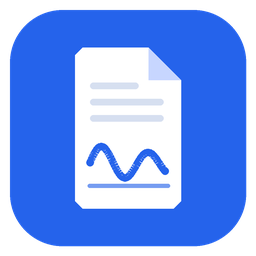
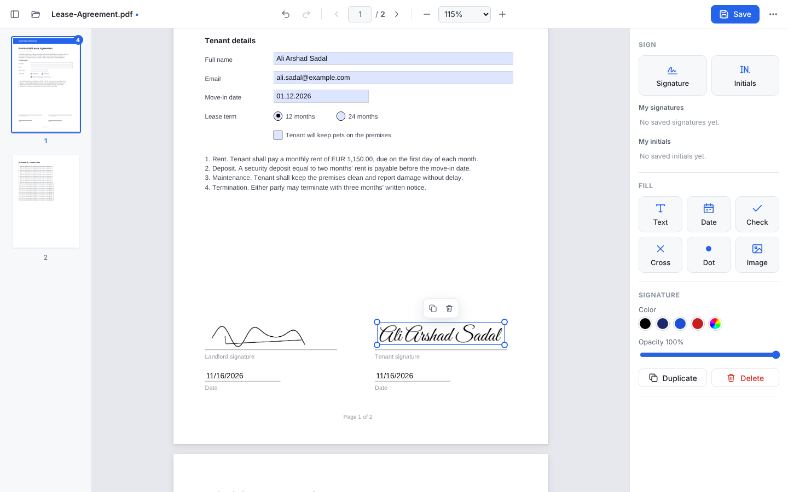
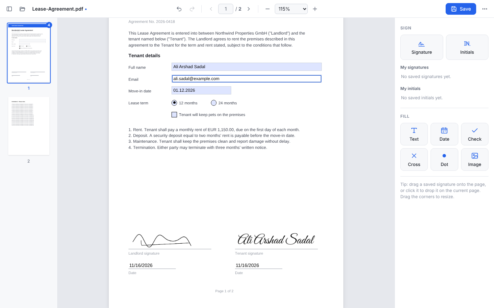
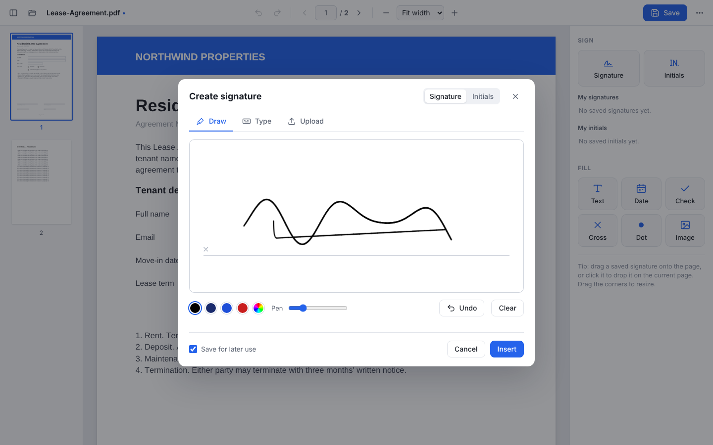
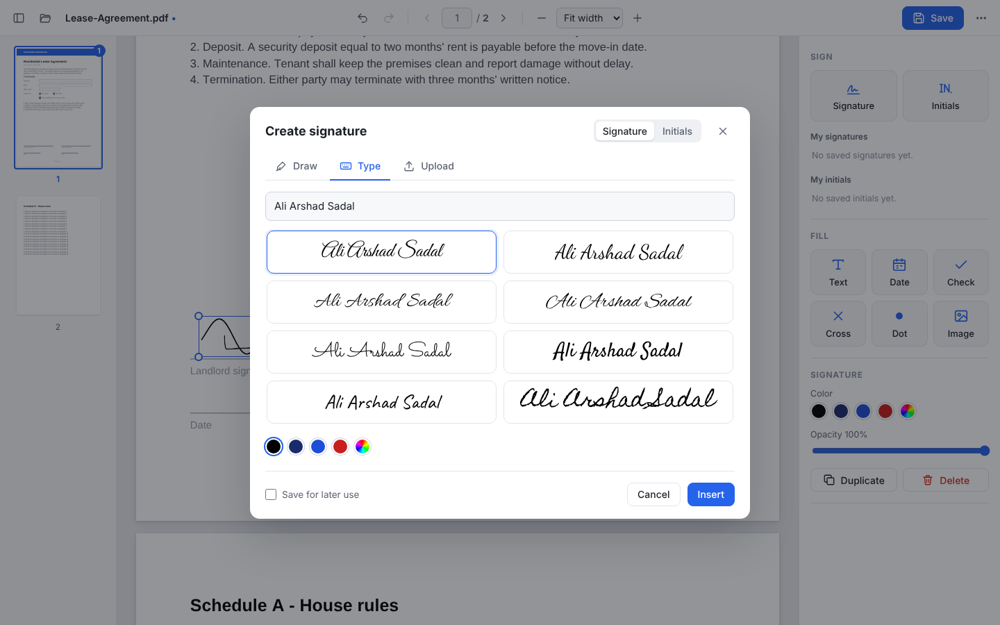
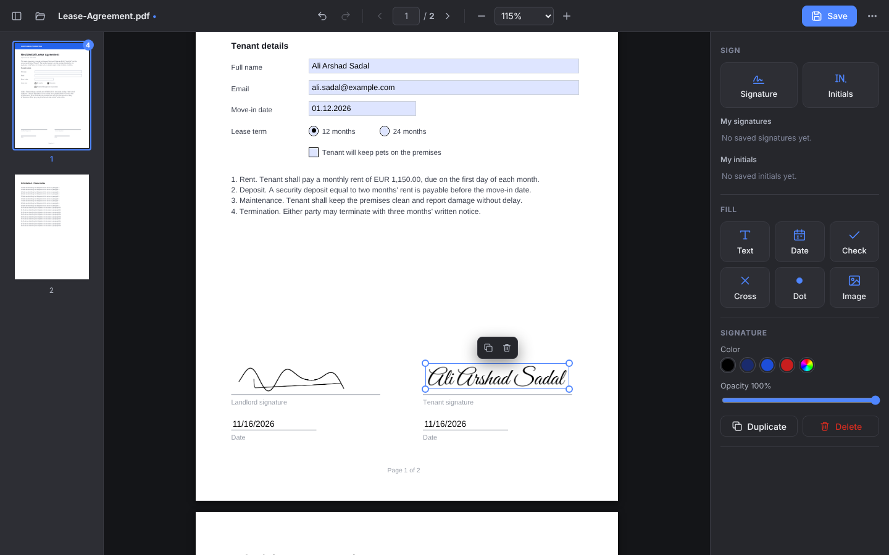
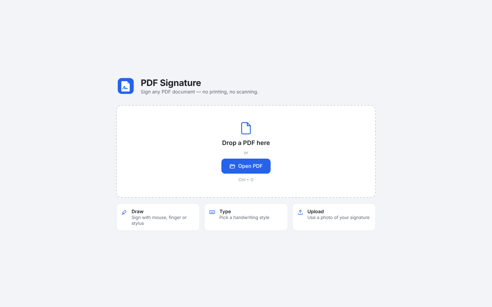

<div align="center">



# PDF Signature: free offline PDF signer for Windows

**Sign PDF documents and fill in PDF forms on Windows, without printing, scanning, accounts or uploads.**
Draw, type or upload your signature, place it anywhere on the page, and save a signed PDF in seconds.

[](https://github.com/asadal12/pdf-signature/releases/latest)
[](https://github.com/asadal12/pdf-signature/releases)
[](LICENSE)

[**Download**](https://github.com/asadal12/pdf-signature/releases/latest) · [Website](https://asadal12.github.io/pdf-signature/) · [Features](#features) · [How to sign a PDF](#how-to-sign-a-pdf) · [FAQ](#faq) · [Build from source](#build-from-source)



</div>

---

## What is PDF Signature?

**PDF Signature** is a free, open-source desktop app for **signing PDF files on Windows**. Open a contract, application form, school document, invoice or any other PDF, add your handwritten signature, initials, text, dates or checkmarks, and save the signed PDF. It is a lightweight alternative to online e-signature services: **everything runs locally on your computer, works offline, and your documents are never uploaded anywhere.**

It also works as a **PDF form filler**. Fillable fields (text boxes, checkboxes, radio buttons, dropdowns and signature fields) can be filled in directly on the page, and they stay editable in the saved file.

## Features

### ✍️ Create your signature three ways
- **Draw:** sign with a mouse, touchpad, finger (touchscreen) or stylus. Stylus **pen pressure** is supported, and line width varies with drawing speed for a natural, ink-like look.
- **Type:** type your name and choose from **8 handwriting fonts** (Great Vibes, Dancing Script, Allura, Alex Brush, Sacramento, Satisfy, Caveat, Homemade Apple).
- **Upload:** use a photo or scan of your signature. **The white paper background is removed automatically** and empty edges are trimmed.
- Separate **signature** and **initials**, in black, navy, blue, red or any custom color.
- **Saved signatures:** reuse them in one click, or drag one onto any page.

### 📄 Sign and fill any PDF
- **Fillable PDF forms (AcroForm):** fill in text fields, multi-line fields, checkboxes, radio buttons and dropdowns. Values are written into the form fields, so the saved PDF stays a fillable form in Adobe Acrobat Reader, Edge, Chrome and other readers.
- **Signature fields:** "Sign here" boxes are detected automatically. Click one and your signature is fitted into the box.
- **Fill & sign tools:** Text (Sans, Serif or Mono font, any size and color), **Date** (6 formats, e.g. `16.11.2026`, `11/16/2026`, `2026-11-16`, `16 November 2026`), **Checkmark ✓**, **Cross ✗**, **Dot ●**, and **Image** (logos, stamps, seals).
- Move, resize, recolor, change opacity, duplicate and delete anything you add, and move items between pages.
- **Undo and redo** for every change.

### 🎯 Accurate output
- **What you see is exactly what you get.** Placement is accurate to a fraction of a point, including on rotated pages (90°/180°/270°), cropped pages and unusual page sizes.
- Text you add stays **real, selectable PDF text**. Characters that standard PDF fonts can't encode are embedded as a high-resolution image.
- Your **original file is never overwritten**: the first save suggests `yourfile-signed.pdf`.
- **Password-protected and restricted PDFs** open with a password prompt and can be saved as a flattened (image-based, 200 dpi) signed copy. The app asks before doing this.

### 🪟 A proper Windows app
- Page thumbnails, page navigation, zoom (fit width, fit page, 10–500%, Ctrl + mouse wheel).
- Drag and drop PDFs onto the window, a **recent files** list, and **"Open with → PDF Signature"** from File Explorer (installer version).
- **Light and dark mode** follow your Windows theme.
- Warns before closing with unsaved changes. Full keyboard shortcuts.
- **100% offline and private:** no account, no telemetry, no network requests.

## Screenshots

| Fill in a PDF form | Draw your signature |
|---|---|
|  |  |
| **Type your signature in 8 handwriting fonts** | **Dark mode** |
|  |  |

<p align="center"></p>

## Download & install

Go to the **[latest release](https://github.com/asadal12/pdf-signature/releases/latest)** and choose one:

| File | What it is |
|---|---|
| `PDF-Signature-Setup-x.y.z.exe` | **Installer (recommended).** Adds Start-menu and desktop shortcuts and an "Open with" entry for PDF files. Uninstall it from *Settings → Apps*. |
| `PDF-Signature-x.y.z-win-x64-portable.zip` | **Portable, no install.** Unzip it anywhere (even a USB stick) and run `PDF Signature.exe`. |

**Requirements:** Windows 10 or Windows 11 (64-bit).

> **"Windows protected your PC"?** The app is not code-signed yet, so Microsoft Defender SmartScreen may warn you the first time. Click **More info → Run anyway**. The full source code is in this repository, so you can review it or build it yourself.

## How to sign a PDF

1. **Open your PDF.** Click **Open PDF**, press **Ctrl+O**, or drag the file onto the window.
2. **Fill in the form fields** if the PDF has any. They are highlighted in blue.
3. **Click _Signature_** (or **Initials**) and draw, type or upload your signature. Keep *Save for later use* ticked to reuse it.
4. **Place it.** It appears on the page you're viewing. Drag it into position and drag a corner to resize it. If the PDF has a "Sign here" field, just click the field.
5. **Add a date, text or checkmarks** from the **Fill** panel if needed.
6. **Click _Save_.** You get a new signed PDF, ready to email, upload or print.

### Keyboard shortcuts

| Shortcut | Action |
|---|---|
| `Ctrl+O` | Open a PDF |
| `Ctrl+S` / `Ctrl+Shift+S` | Save / Save as |
| `Ctrl+Z` / `Ctrl+Y` | Undo / Redo |
| `Delete` | Delete the selected item |
| `Ctrl+D` | Duplicate the selected item |
| Arrow keys (`Shift` = ×10) | Nudge the selected item |
| `Enter` or double-click | Edit the selected text |
| `Esc` | Finish editing / deselect |
| `Ctrl +` / `Ctrl −` / `Ctrl 0` | Zoom in / zoom out / fit width |
| `PgUp` / `PgDn`, `Home` / `End` | Previous / next page, first / last page |

## FAQ

**Is PDF Signature free?**
Yes. It's free and open source under the MIT license, with no ads, no watermark, no trial and no sign-up.

**Are my documents uploaded to a server?**
No. Everything happens locally on your PC, and the app works with no internet connection at all. Saved signatures are stored only on your computer.

**Can I fill out PDF forms with it?**
Yes. Standard fillable PDF forms (AcroForm) are supported: text fields, checkboxes, radio buttons, dropdowns and signature fields. Dynamic XFA forms (an older Adobe LiveCycle format used by a few government forms) are not supported.

**Is the signature legally binding?**
PDF Signature adds a **visual electronic signature**: an image of your handwritten signature, like signing a printout and scanning it. That is accepted for many everyday documents (leases, school forms, HR paperwork, quotes and invoices). It is **not** a certificate-based cryptographic digital signature (PAdES / qualified electronic signature), which some legal or government processes require. If in doubt, ask the person who requested your signature.

**Will it change or overwrite my original PDF?**
No. It saves a new file named `…-signed.pdf` unless you choose a different name.

**Can I sign on a touchscreen or with a pen?**
Yes. Finger and stylus input are supported, including pen pressure.

**Does it work on macOS or Linux?**
The official releases are for Windows. The app is built with Electron, so you can run it from source on macOS or Linux with `npm start`.

## Build from source

You need [Node.js](https://nodejs.org) 20 or newer.

```bash
git clone https://github.com/asadal12/pdf-signature.git
cd pdf-signature
npm install
npm start            # run the app in development
npm run package      # portable Windows build → dist/PDF Signature-win32-x64
npm run dist         # Windows installer (NSIS) → dist/PDF-Signature-Setup-x.y.z.exe
```

### How it works

| Part | Technology |
|---|---|
| Desktop shell | [Electron](https://www.electronjs.org/), with a sandboxed renderer, context isolation, a strict Content-Security-Policy and a private `app://` protocol |
| PDF rendering and form fields | [pdf.js](https://github.com/mozilla/pdf.js) (Mozilla), including its annotation layer for interactive AcroForm fields |
| Writing the signed PDF | [pdf-lib](https://github.com/Hopding/pdf-lib): signatures and images are embedded as images, text as real PDF text with standard fonts |
| Form values | written by pdf.js (with generated appearance streams), then normalized onto the field objects so every PDF reader shows them |
| Handwriting fonts | open-source fonts via [Fontsource](https://fontsource.org) |

Coordinates are converted from screen space to PDF user space with the page's own viewport transform. That's why rotated pages, offset crop boxes and page content with unbalanced graphics state all come out correctly.

```
main.js          Electron main process: window, file dialogs, app:// protocol, unsaved-changes guard
preload.js       Minimal, safe bridge between the UI and the file system
src/index.html   UI markup
src/styles.css   Styles (light + dark)
src/app.js       Viewer, signature pad, form fields, placement, undo/redo, saving
src/vendor/      pdf.js, pdf-lib, CMaps, standard fonts
src/fonts/       Handwriting fonts
build/           App icons
docs/            Website (GitHub Pages) and screenshots
```

The app also runs in a normal browser: serve the `src` folder with any static file server and open `index.html`. In that mode saving downloads the signed PDF.

## Contributing

Bug reports, feature requests and pull requests are welcome. Please [open an issue](https://github.com/asadal12/pdf-signature/issues) and attach a sample PDF if the problem is document-specific (remove any personal data first).

## License

[MIT](LICENSE) © 2026 Ali Arshad Sadal. Bundled third-party components are listed in [THIRD_PARTY_NOTICES.md](THIRD_PARTY_NOTICES.md).

---

<sub>Keywords: sign PDF, PDF signer, free PDF signature app, e-sign PDF offline, electronic signature Windows, add signature to PDF, fill and sign PDF, PDF form filler, sign documents without printing, DocuSign alternative, Adobe Fill & Sign alternative, open source PDF signing.</sub>
